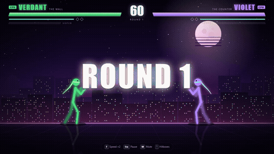
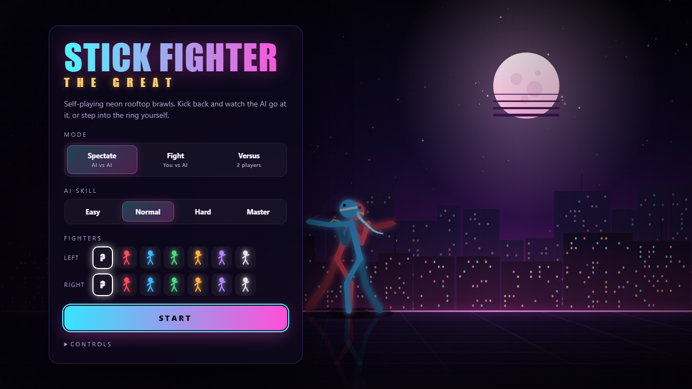
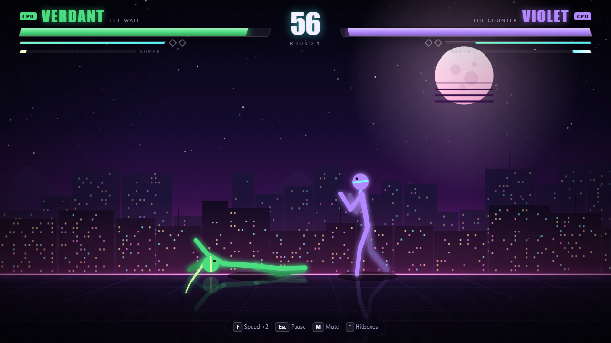
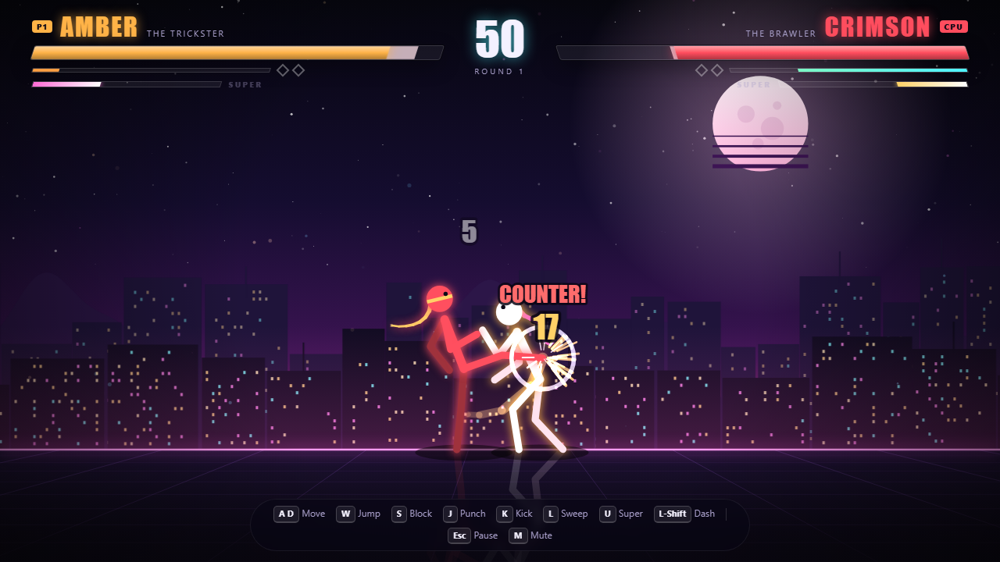
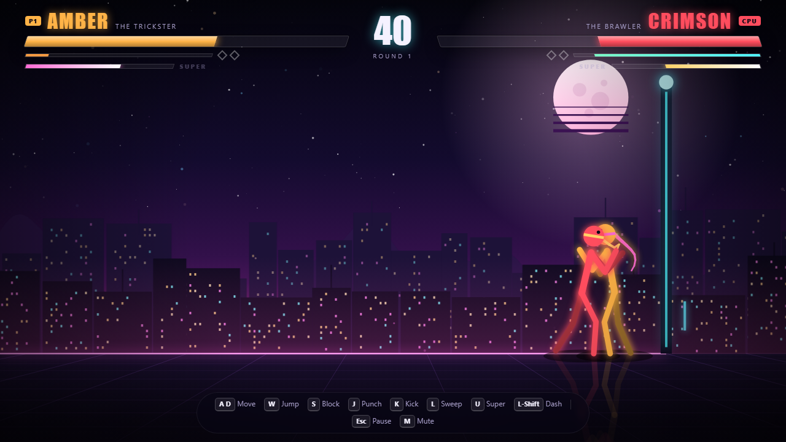

# Stick Fighter: The Great

A self-playing neon stick-figure fighting game. Sit back and watch two AI fighters brawl on a synthwave rooftop, or step in yourself against the CPU or a friend on the same keyboard.

Vanilla JavaScript + Canvas 2D, bundled with Vite. No runtime dependencies.

[](docs/gameplay.webm)

*Click the preview for the full gameplay clip ([gameplay.webm](docs/gameplay.webm)).*

| Menu | Spectate |
| --- | --- |
|  |  |
| **Fight (you vs AI)** | **Fight (late round)** |
|  |  |

## Getting started

```bash
npm install
npm run dev      # http://localhost:3000
npm run build    # production bundle in dist/
npm run preview  # serve the built bundle
```

## Modes

| Mode | Who fights |
| --- | --- |
| Spectate | AI vs AI, matches roll on automatically (also plays behind the main menu) |
| Fight | You (P1) vs AI |
| Versus | P1 vs P2 on one keyboard |

Difficulty (Easy / Normal / Hard / Master) sets the AI's reaction time, blocking, accuracy, anti-air and combo skill. Each of the six fighters also has its own stats and personality (aggression, caution, jumpiness, kick preference, combo drive). Pick fighters or leave them on `?` for random.

## Controls

| Action | Player 1 | Player 2 |
| --- | --- | --- |
| Move | A / D | ← / → |
| Jump | W | ↑ |
| Block | S | ↓ |
| Punch (jab → cross → uppercut) | J | , or Numpad 1 |
| Kick (roundhouse; flying kick in the air) | K | . or Numpad 2 |
| Sweep | L | / or Numpad 3 |
| Super (full meter) | U | ; or Numpad 5 |
| Dash (held direction, else backward) | Left Shift | Right Shift or Numpad 0 |

Global: `Esc`/`P` pause, `M` mute, `F` toggle 2× speed (spectate), `` ` `` toggle hitbox overlay.

## Combat

- Moves have frame data (startup / active / recovery), and hits can cancel into follow-ups for combos (damage scales down the longer a combo runs; juggles are capped).
- Blocking takes chip damage and drains stamina. An empty stamina bar means a guard break.
- Hitting an opponent during their startup is a **counter hit** for bonus damage.
- Sweeps, supers and juggle finishers cause knockdowns; a KO turns the loser into a ragdoll.
- Dealing and taking damage builds super meter. At 100 the **Dragon Fist** is ready.
- Best of 3 rounds, 60 seconds each. Time over goes to the fighter with more health.

## Project structure

```
src/
├── main.js                 # composition root: builds and wires every system
├── errors/GameErrors.js    # custom exception hierarchy
├── utils/                  # decorators (error boundaries, circuit breaker, validation), math, color, EventBus, settings
├── config/                 # game tuning, difficulty presets, fighter roster, key bindings
├── core/                   # GameEngine, GameLoop (fixed step), MatchDirector (rounds), InputManager
├── entities/               # Fighter + components (FighterBody, Vitals, Ragdoll), createFighter factory
├── animation/              # Skeleton (forward kinematics), poses, Animator
├── combat/                 # move frame data, HitResolver
├── controllers/            # HumanController, AIController, createControllers
├── systems/                # FeedbackDirector (maps game events to particles, shake, sound)
├── render/                 # Renderer, Camera, backdrop/stage/fighter painters, effects
├── audio/SoundFX.js        # synthesized WebAudio effects
└── ui/                     # HUD, Announcer, HintBar, MenuController
```

### Design notes

- **Composition over inheritance.** A `Fighter` is assembled from a `FighterBody`, `Vitals`, `Animator`, `Scarf` and so on. Controllers only produce *intents* (`{ move, jump, block, attack, dash }`), so human and AI players drive fighters the same way.
- **Dependency injection.** `main.js` builds every collaborator and passes it in. `GameEngine` never imports concrete renderers, audio or UI.
- **Event-driven feedback.** Gameplay emits events (`combat:hit`, `fighter:ko`, `round:over`, …). The FeedbackDirector, Announcer and SoundFX react to them without gameplay knowing they exist.
- **Error handling.** `utils/decorators.js` provides `withErrorBoundary`, `withCircuitBreaker` and `withValidation` (plus method-decorator factories). These wrap the game loop, event listeners, audio, HUD and factories. Errors come from a hierarchy in `errors/GameErrors.js` (`ConfigurationError`, `InitializationError`, `StateError`, `RuntimeLoopError`, `AudioError`, …).

### Tweaking

- Balance, physics, timers and the camera live in `src/config/gameConfig.js`.
- Add a fighter by appending a profile to `src/config/fighterRoster.js`.
- Add or tune moves in `src/combat/moves.js` (frame data plus windup/strike poses).
- AI difficulty presets live in `src/config/difficulty.js`.

In dev, `window.stickFighter` exposes `{ engine, loop, settings }` for poking at a live match (e.g. `stickFighter.loop.timeScale = 4`).
